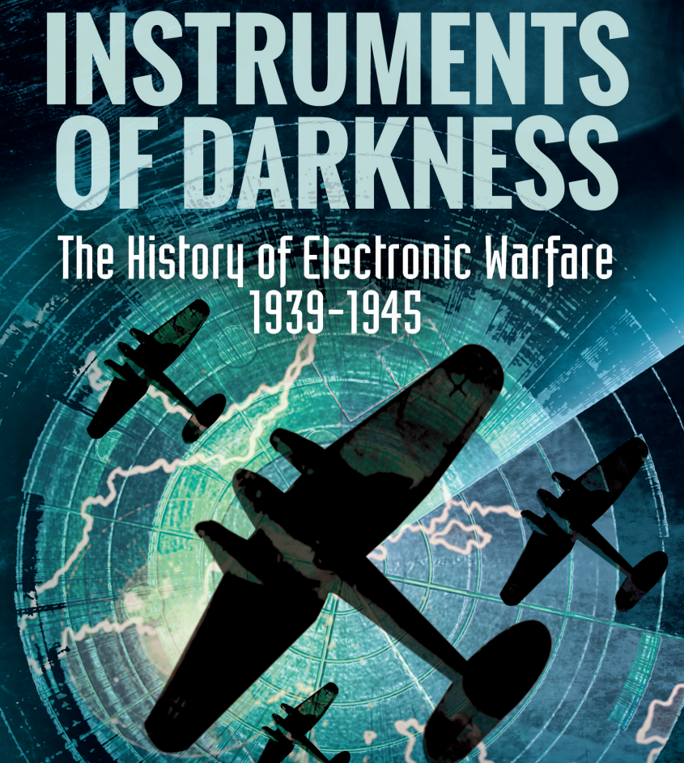
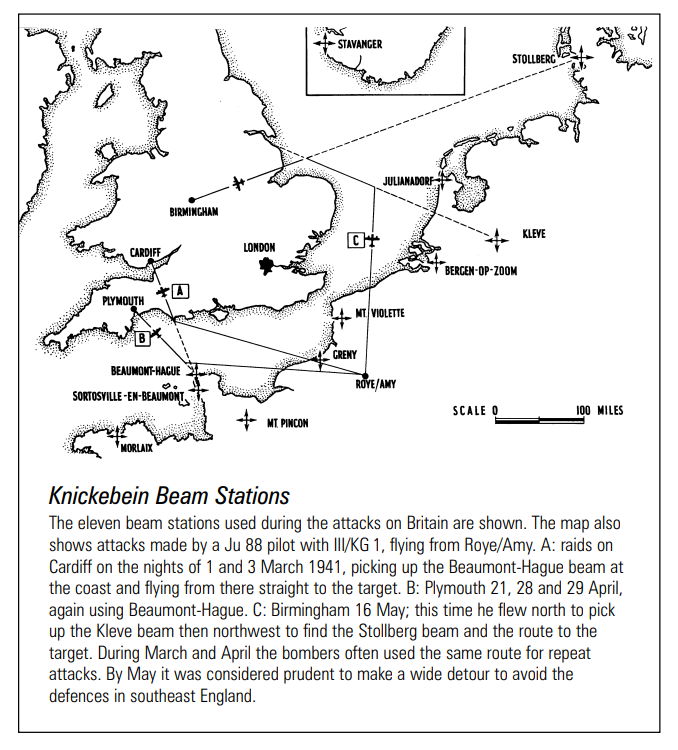
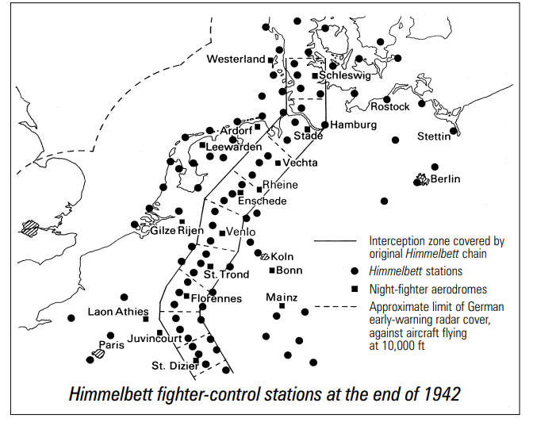
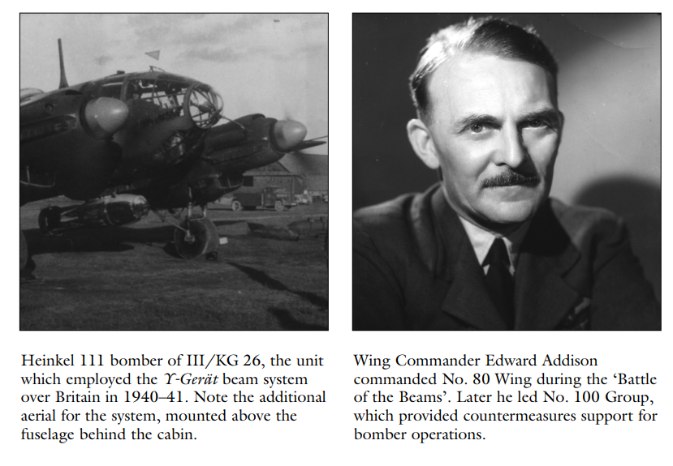
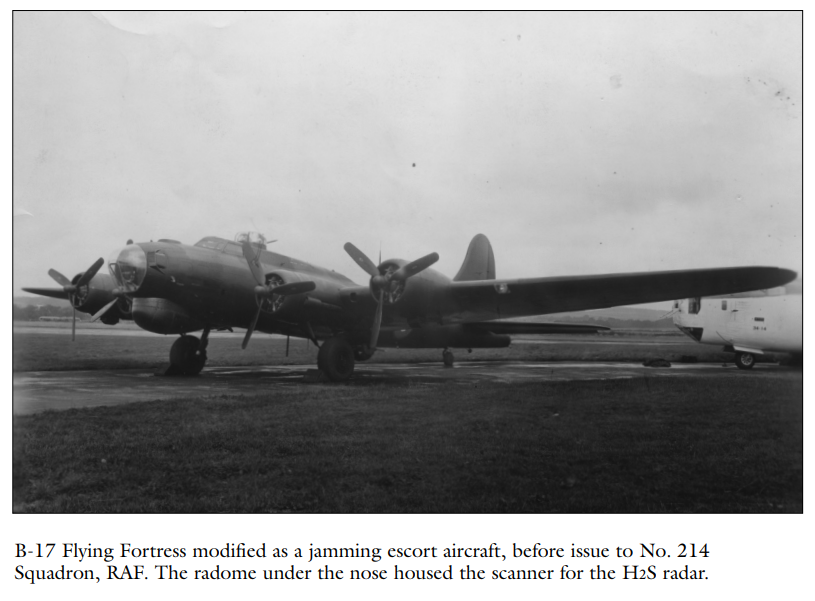
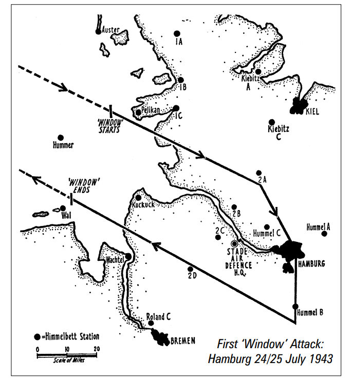

# A Hidden Electronic Warfare "Creation" - Why "Instruments of Darkness" is Worth Deep Reading

An Underrated Electronic Warfare "Creation of the Worlds" - Why "Instruments of Darkness" is Worth Deep Reading
Electronic warfare is not a Cold War product, its "creation" dates back to World War II.
Greenhill Press reissued "Instruments of Darkness: The History of Electronic Warfare, 1939–1945" in 2017, authored by former Royal Air Force officer and top military aviation historian Alfred Price. This is the most authoritative "birth certificate" for this technological revolution.
This book was first published in early 1967, undergoing three revisions and has been hailed as the bible of electronic warfare history. It is not only a history of battles but also an encyclopedia of technical intelligence confrontation.
1. The "Technological Tree" Turns into a Weapon: This War Is Not Just About Steel Currents
Let's delve into several real-life examples that are so vivid they seem to reach down to the very pores.
1. "Beam Battle": The astonishing intuition of technical intelligence 1940 June, young British science intelligence officer R. V. Jones found that the Germans seemed to have a night-time precise navigation system. Various clues point to a device called "Knickebein".
The British have found it. On the Anson aircraft flying over central England, the radio operator heard Morse code signals on frequency 31.5MHz — several radio beams crossing the English Channel and eventually converging at Rolls-Royce's aeroengine factory in Derby.
This was the first victory in history of Electronic Intelligence (ELINT) operations.
The subsequent confrontation almost established the basic pattern of electronic warfare: The German "Kneeling" beam system was suppressed by the "Aspirin" jamming machine; more sophisticated "X-device" and "Y-device" were successively introduced, but were then countered by the "Bromide" and "Domino" jammers. The British Eighth Army expanded to over 2,000 people in 1941, controlling over 150 decoy fires.
Core insight: Technological advantage is temporary, and true moats are those that reveal vulnerabilities to technology.
2. The obsession with "shells": A historic delay in a simple technology
In the summer of 1941, scientists at the British Telecommunications Research Establishment had proven that releasing a large amount of metal foils could form a saturation interference with radar. This method, called the "Window," was so simple as to be unbelievable.
However, it was shelved for 18 months.
Opponents, including Professor Lindemann, Chief Scientific Advisor to Winston Churchill, worried: If the Germans replicated this, the British homeland's air defense network would collapse instantly. The debate around the "Window" evolved into a strategic gamble: When to use this "ultimate weapon" to achieve maximum effect?
On the night of July 24, 1943, Hamburg. The "Mothra operation" commenced. 791 bombers released foils at the rate of one per minute over Hamburg. The German radar screens turned into a sea of snowflakes, and the orderly "Camouflage Line" was instantly paralyzed. Overnight, the battle damage rate plummeted.
What was even more shocking was the subsequent reaction. General Gallian, the German Air Force Chief, recalled: "I have never seen such unity and anxiety among the leaders of the Air Force." Nazi emergency plans were to urgently call up the "Pig" tactic - letting single-seater fighter pilots intercept bombers with naked eyes and searchlights, resulting in significant combat losses and "friendly fire" mishaps.
Technological insight: The best electronic countermeasures are often simple, violent, and test the courage of those who break away from the "status quo bias."
3. "D-Day's 'Ghost Fleet': The Most Precise Strategic Deception in History"
On the night of June 5, 1944, over the English Channel, 18 small boats without any heavy equipment were towed behind balloons with reflectors attached, slowly moving towards Calais under carefully calculated barrages of flak clouds. Accompanied by Lancasters flying precisely "square" routes.
In the German radar screens, two massive "ghost fleets" were moving towards Le Havre and Boulogne - this was the core chapter of the "Guardian Plan" of strategic deception.
Price cited German records showing that even as landings had already begun, the 15th Army Group firmly believed Normandy was just a feint, with the real threat lurking in Calais. Post-war strategic bombing investigations confirmed that this deceptive operation delayed the German effective counterattack for at least four weeks.
Strategic insight: The core of modern electronic warfare is not about damage but about controlling the enemy's "cognitive space."
II. The Unparalleled Value of "Instruments of Darkness"
There are numerous books on WWII technology history or code warfare, but this book has an irreplaceable unique value:
1. A pioneering work in its field Price is the first historian to define electronic countermeasures as a complete domain of war. He established a coherent narrative of technological evolution, allowing readers to understand how each form of interference and every reconnaissance flight affected the battlefield.
2. Perfect "technology-tactics-strategy" triad perspective Authors leverage their Royal Air Force officer experience and expertise in German archives to achieve a perfect balance between technical principles and tactical application. You can understand the physical principles of the "Mendel" jammer while intuitively feeling its devastating impact on German night fighter guidance.
3. The book's historical depth is unparalleled. Its core sources include: in-depth interviews with scientists involved in the war (Jones, Cockburn), the latest declassified Ultra intelligence documents, records from high-level German Air Force meetings, and the results of the post-war "posthumous autopsies" exercise. From the low frequency long-range warning radar of the German army, "Mammoth", to the Japanese Navy's "Mark I", the technical details are detailed.
4. The book features a built-in "Historical Sandbox Simulation" feature, serving as a ready-made blueprint for "military board games." The recurring mention of the "delay" issue (such as the 18-month delay for the "window" and the abandonment of German Düppel) forms an ideal case: technological advantages are temporary, and factors such as technological intelligence, production cycles, organizational bureaucracy, tactical adaptation, and more collectively determine victory or defeat.
III. Why today we still need to read this history: Some may ask, with our hands on cognitive electronic warfare and AI technology, revisiting the foil strips from 70 years ago is outdated?
Price has the answer in the book. His records reveal a fundamental pattern that remains unchanged to this day:
Attacks always lead to defenses. The British "Gee" navigation system was quickly suppressed by the "Heinrich" jamming aircraft, and it took "Oboe" systems a year to find an anti-jamming solution for TBMs â€" not absolute superiority but rather half a step ahead in adapting to its opponents.
Electronic warfare is a game of probability, not magic. The 100th Brigade's assessment shows that sustained electronic jamming has reduced the RAF night bomber's combat loss rate by about one percentage point—in a long-term war of attrition, this means more than 1,000 bombers and thousands of aircrew.
The dimension of psychological warfare always exists. In 1940, when the British interfered with the "kneeling" beams, the interference signal itself was very weak, and German pilots did not completely lose the signal. However, they understand that the British know the beam's direction, and psychological deterrence is far more intimidating than physical suppression.
The current terminology in AI-driven cognitive electronic warfare, adaptive interference, and electromagnetic maneuver warfare essentially perpetuates the game of Price: exploiting an opponent's reliance on the electromagnetic spectrum to attack their perception chain and OODA (Observe - Decide - Act - React) loop.
"Instruments of Darkness" is valuable for its ability to encapsulate these eternal principles into real, tangible historical scenarios.
Target audiences include engineers and researchers in the fields of electronic warfare, radar, and communications—to reveal how core technological principles can be transformed into disruptive tactical advantages;
Military history enthusiasts—with flesh-and-blood archival details that fill in the crucial pieces for grand narratives like "Triumphant Actions";
Strategic decision-makers and defense planners—to present the complex interplay between technology, intelligence, and strategy.

## Images

<!-- PAYMENT_BLOCK -->

## Get this dataset

- Payment link (Stripe): [Buy now](https://buy.stripe.com/3cs8yP7sY87d0vu9AB)
- Payment QR code: 

<!-- /PAYMENT_BLOCK -->
